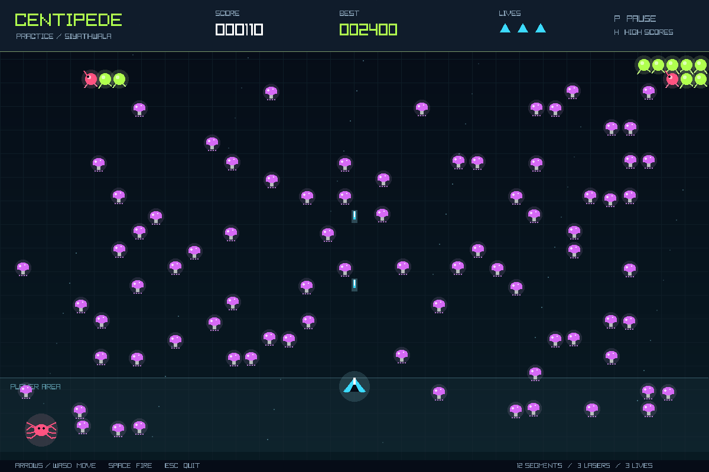

# Centipede Practice

A complete C++20 arcade practice game for SiyaThwala's `cpp-practice` repository.
The original arcade concept is Centipede by Atari; this project uses raylib for
the window, keyboard input and drawing.



## Play

- Clear all 12 centipede segments to win.
- A segment hit is worth 100 points and creates a mushroom where space permits.
- Hitting an interior segment splits the centipede into independent chains.
- Mushrooms take four hits to destroy and award 10 points.
- The fixed field contains 80 irregularly scattered mushrooms; restarting
  restores the same layout rather than generating a new field.
- A spider enters from either side near the lower field, varies its movement,
  sometimes eats mushrooms, and eventually exits. Shooting it awards 300 points.
- Contact with a spider or centipede costs a life. Surviving a hit grants two
  seconds of protection. Lose all three lives, or let a centipede head reach
  the bottom boundary, and the game ends.
- Up to three lasers can exist at once. Hold Space to keep firing.
- Completed games record positive scores in the five-entry high-score list.
  Closing a game before it ends does not submit its score.

## Controls

| Key | Action |
| --- | --- |
| Enter | Start from the menu or play again after a game |
| Arrow keys / WASD | Move within the lower player area |
| Space | Shoot |
| P | Pause / resume |
| H | View / close saved high scores; active gameplay pauses automatically |
| R | Restart while paused or after a game |
| Escape | Quit |

## Build on Windows (Git Bash + MinGW)

Use the CMake and MinGW tools already installed for your C++ work. You need
CMake 3.25 or newer, a C++20 compiler, Git and an OpenGL-capable graphics driver.
The first configuration downloads raylib 6.0 if it is not installed.

From the **cpp-practice repository root**:

```bash
cmake -S centipede -B centipede/build -G "MinGW Makefiles" -DCMAKE_BUILD_TYPE=Release
cmake --build centipede/build --parallel 4
./centipede/bin/game.exe
```

Run the tests:

```bash
./centipede/bin/tests.exe
```

Or use CTest:

```bash
ctest --test-dir centipede/build --output-on-failure
```

If your terminal is already inside `centipede`, use `-S . -B build` and
run `./bin/game.exe` instead.

## Saved scores

Scores live in `centipede/bin/data/high-scores.txt`, beside the executable.
The game resolves this path from the application directory, so it can also
be launched from another folder. Missing or malformed score data is tolerated.
If the directory is not writable, the result screen reports that saving failed.
Generated executables, build files and local scores are ignored by Git.

## File responsibilities

| File | Responsibility |
| --- | --- |
| `src/main.cpp` | Window lifetime, keyboard input, screen navigation and fixed simulation timing |
| `src/GameModel.h` | Game objects, states, read-only accessors and gameplay interface |
| `src/GameModel.cpp` | Fixed field, shooting, splitting, movement, collisions, lives and scoring |
| `src/HighScores.h/.cpp` | Read, sort, trim and persist completed-game scores |
| `src/Renderer.h/.cpp` | Neon arcade graphics, HUD, control menu, pause and score screens |
| `tests/tests.cpp` | 25 independent behavior tests; no graphics window is required |
| `CMakeLists.txt` | Build the core, game and tests; fetch raylib when needed |

Movement runs at a fixed 120 simulation steps per second. Drawing targets
60 frames per second. Swept laser collision checks stop fast lasers skipping
over thin targets and select the nearest target along each laser's path.

The graphics use shapes and the default raylib font. No image files or
external resource layouts are required to play. There is no sound in this version.

## Tests without graphics dependencies

```bash
cmake -S centipede -B centipede/build-core -DCENTIPEDE_BUILD_GAME=OFF
cmake --build centipede/build-core
ctest --test-dir centipede/build-core --output-on-failure
```

See [raylib](https://www.raylib.com/) and its
[source repository](https://github.com/raysan5/raylib) for dependency documentation.
