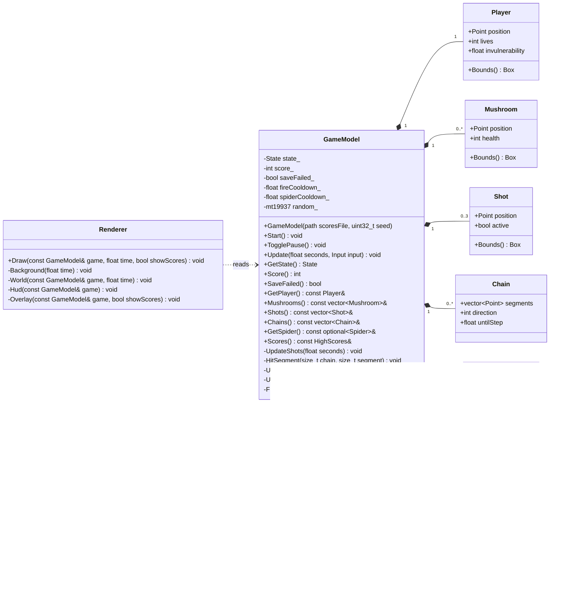
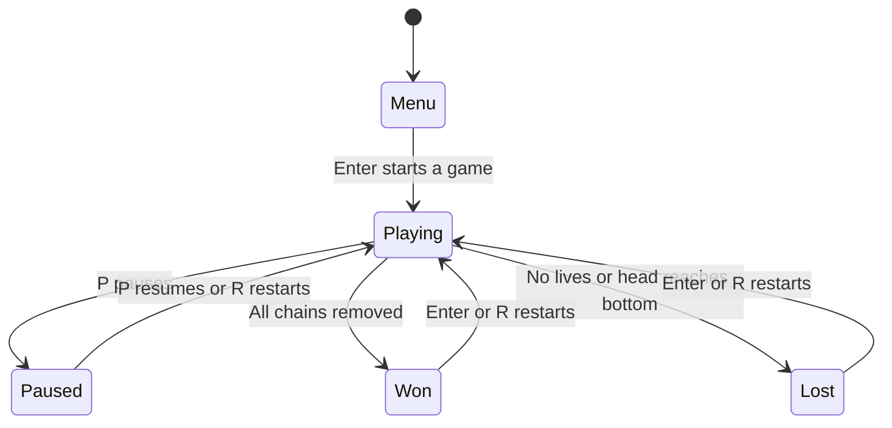
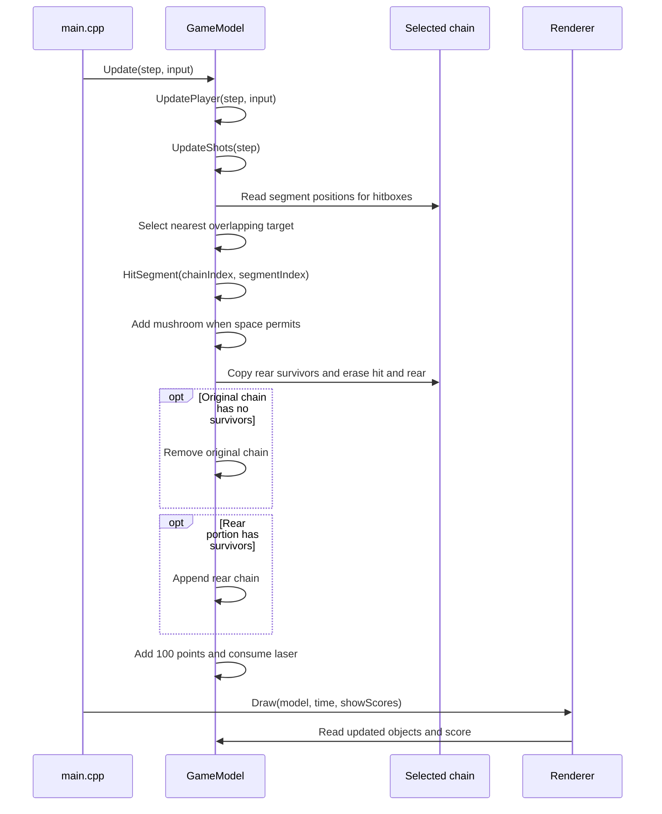
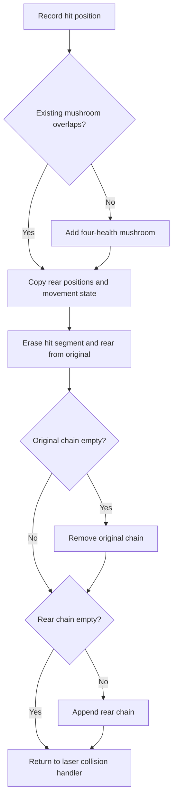
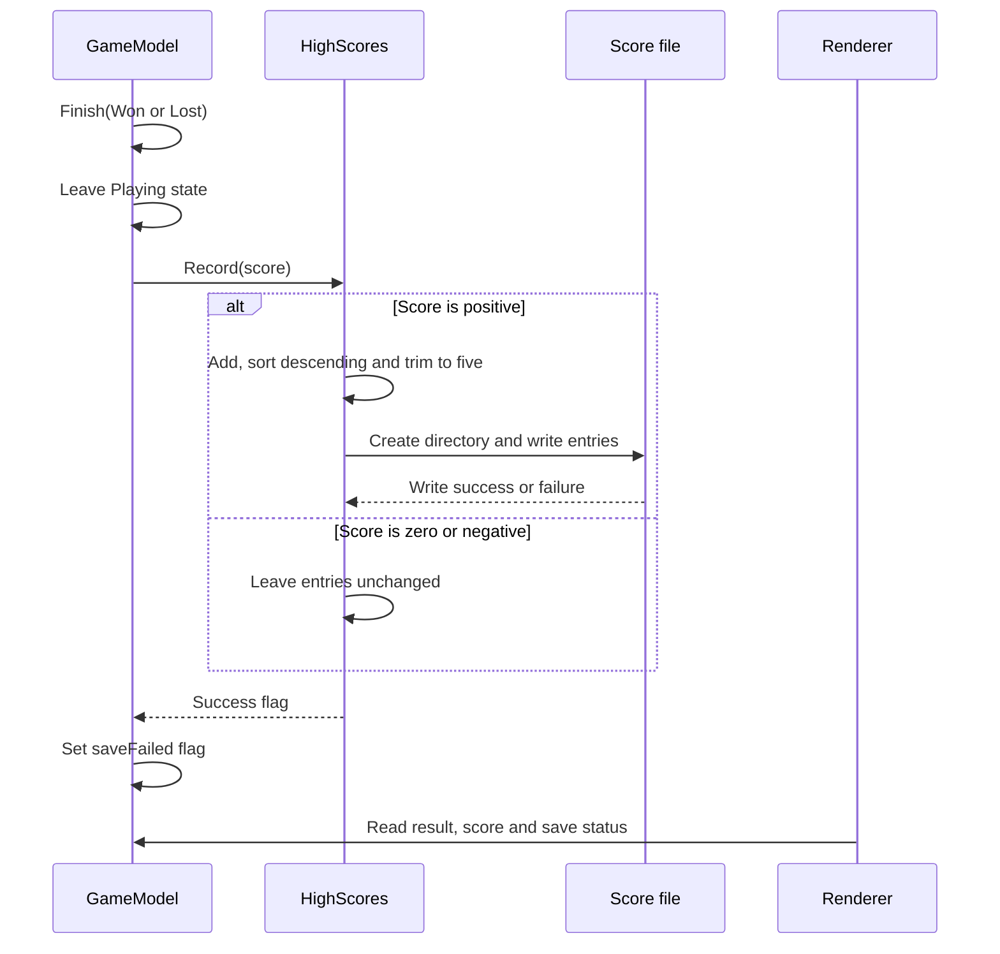

# Centipede Practice Architecture

This document describes the current C++20 practice game: its objects, their
relationships, and the algorithms behind movement, collisions and scoring.
It also explains why particular functions and C++ features are used.

## Architectural overview

The game has three main responsibilities. `main.cpp` owns the window and
translates keyboard input into commands. `GameModel` owns gameplay state and
applies the game rules. `Renderer` reads that state and draws it using raylib.
`HighScores` handles the small persistent score file.

The gameplay model has no raylib dependency. Tests can therefore simulate
movement and collisions without opening a window. Rendering uses const
references and getters so drawing does not change gameplay state.

## Domain model

The player controls a Bug Blaster represented by `Player`. It starts with three
lives and can move in the lower field. `Shot` represents one upward laser;
at most three lasers are active at once. `Mushroom` stores a position and four
initial health points. `Chain` stores an ordered collection of centipede
segment positions: its first element is the head. A new game has one chain
containing twelve segments. `Spider` stores the side-moving enemy's position,
direction and movement timers.

These game objects are currently structs with public data. Their movement,
damage and lifecycle rules are implemented by `GameModel`. `Point`, `Box` and
`Input` are small value types for coordinates, rectangular bounds and input.

The screen is 1200 by 800 pixels. Gameplay begins at y = 100. The player's
top boundary is y = 640 and its bottom edge cannot exceed y = 766. The spider
can move higher, with its top-left y coordinate between 520 and 738.

### Collision boundaries and scoring

`Intersects(Box a, Box b)` performs an axis-aligned rectangle overlap check.
Both horizontal and vertical intervals must overlap. Strict comparisons mean
that touching edges alone do not count as a collision. The rectangles are
logical hitboxes; decorative legs and glow can extend beyond them.

| Event | Result |
| --- | --- |
| Laser hits a centipede segment | Remove that segment; add a mushroom if none overlaps its hitbox; award 100 points |
| Interior centipede segment is removed | Separate the front and rear surviving portions into chains |
| Laser hits a mushroom | Reduce its health; on the fourth hit remove it and award 10 points |
| Laser hits the spider | Remove the spider, award 300 points and begin its respawn delay |
| Vulnerable player touches an enemy | Lose one life; a surviving player returns to its starting position and gets two seconds of protection |
| All centipede segments are removed | Win and record the completed-game score |
| A head reaches the bottom boundary, or the player loses all lives | Lose and record the completed-game score |

Mushrooms do not block player movement. A spider can eat an overlapping
mushroom without awarding points to the player.

## File responsibilities

| File | Responsibility and connection |
| --- | --- |
| `src/main.cpp` | Creates the raylib window, constructs the model and renderer, reads keys, advances simulation time and draws frames |
| `src/GameModel.h` | Declares the value types, game objects, states and public gameplay interface |
| `src/GameModel.cpp` | Implements the fixed field, movement, collisions, splitting, lives, score changes and game completion |
| `src/HighScores.h` / `.cpp` | Loads, ranks and saves the five best positive completed-game scores; owned by `GameModel` |
| `src/Renderer.h` / `.cpp` | Draws objects, HUD and screen overlays using the model's read-only interface |
| `tests/tests.cpp` | Tests gameplay and score persistence; uses `ModelTestAccess` to arrange internal scenarios |
| `CMakeLists.txt` | Builds the gameplay library, graphical game and tests; obtains raylib when needed |

## Overall class and struct diagram

Selected members are shown below. `+` means public and `-` means private.
Composition means that the containing object owns the value or collection.
`Renderer` uses the model temporarily during drawing and does not own it.

The namespace is `centipede` for gameplay types. `Renderer` and `HighScores`
are declared outside that namespace. There is no inheritance hierarchy in
this implementation. Query functions and `Bounds()` are const-qualified in
the source; the diagram abbreviates their declarations.

## States and screen navigation

The high-score screen is a separate `showScores` flag in `main.cpp`, rather
than another `State` value. Pressing H during play pauses the model and
remembers that it should resume when H closes the screen. Opening the score
screen from an already paused game keeps it paused on return. Escape or
closing the window ends the application from any screen.

## Key interaction: a laser destroys a centipede segment

The sequence below assumes that a centipede segment is the nearest target.
`Chain` is a data object; its arrows describe direct reads and writes, not
member functions implemented on `Chain`.

## Complex functions: what they do and why

### `GameModel::CreateField()` — a repeatable scattered layout

The function builds candidate positions on a 35-column, 20-row grid. It
rejects candidates whose mushroom bounds overlap a rectangle around the
player's starting region. A locally seeded generator shuffles the remaining
candidates; the first 80 are selected. Each selected position receives an
x and y offset between -3 and +3 pixels.

The grid guarantees spacing without repeatedly generating positions and
checking every previous mushroom. Even with offsets, the minimum separation
between adjacent candidate coordinates is 26 pixels horizontally and 24
vertically, exceeding the 20-pixel mushroom dimensions. Shuffling and offsets
produce an irregular field rather than a complete visible grid.

The generator is recreated with seed `3024048` on each reset. Restarting
therefore restores the same layout within the same build. Standard-library
shuffle and distribution implementations can produce different layouts on
different toolchains. Spider randomness uses a separate generator, so it does
not change the mushroom field.

### `GameModel::UpdatePlayer(float seconds, Input input)` — fair movement and firing

Each movement axis is clamped to the range -1 to +1. The function calculates
the length of the movement vector using `std::sqrt`. If its length exceeds
one, it divides both components by that length. This prevents simultaneous
horizontal and vertical input from giving the player a faster diagonal speed.

Movement is multiplied by 310 pixels per second and elapsed simulation time.
`std::clamp` keeps the complete player rectangle inside its permitted area.
Protection and fire-delay timers decrease towards zero. Holding fire creates
a shot only when the delay has expired and fewer than three shots exist.
The next shot is delayed by 0.16 seconds.

Normalization makes movement consistent; boundaries keep the player visible;
the cooldown and shot limit prevent unlimited firing.

### `GameModel::UpdateShots(float seconds)` — swept collision and nearest target

A laser moves upward at 700 pixels per second. Checking only its final
position could miss an object crossed between two updates. The function
therefore forms a rectangle covering the laser's old and new positions,
including its 14-pixel height. This is its swept collision region.

A local `consider` lambda checks each mushroom, the optional spider, and
every centipede segment. For an overlapping target it calculates the distance
from the old laser top to the target's bottom edge, clamped to zero. It retains
the target with the smallest distance. A nearer object therefore wins even
if a farther object was examined first. Equal distances keep the first
candidate encountered: mushrooms, then spider, then segments in collection order.

Only the selected target is affected. Mushroom health decreases, a spider is
removed, or `HitSegment` changes a chain. The corresponding score is updated
and the laser is consumed. Lasers also expire when their complete height
passes above the field. `std::erase_if` removes inactive lasers after the loop,
avoiding invalidation of the laser reference during iteration.

This algorithm prevents skipped targets and multiple hits from one laser.
It checks the targets' positions at this stage of the update; it is not a
continuous collision calculation for both moving lasers and moving enemies.

### `GameModel::HitSegment(size_t chainIndex, size_t segmentIndex)` — safe splitting

The caller supplies indexes found by the collision search. The function first
records the segment position and checks whether adding a mushroom would
overlap an existing mushroom. It then copies all positions after the hit
into a temporary rear chain, preserving the direction and step timer.

Erasing from the hit index to the end leaves the front survivors in the
original chain. An empty original chain is removed. A nonempty rear chain
is appended, with its first position implicitly becoming its head.

The same algorithm handles head, tail, interior and final-segment hits.
Copying the rear before erasing preserves its data. Appending it with
`std::move` transfers its storage into the collection. The original chain
reference is not used after removing or appending collection elements, which
may invalidate references. Scoring remains in `UpdateShots`, keeping this
function focused on the structural change and mushroom placement.

### `GameModel::UpdateChains(float seconds)` — following a head's path

Each chain has a countdown to its next movement step. When due, its head
attempts a horizontal move of 24 pixels. Crossing an edge or overlapping a
mushroom changes this to a downward move of 24 pixels and reverses direction.

The segment positions are copied backwards through the collection: the last
segment receives its predecessor's position, continuing towards the head.
Finally the head receives its new position. Backward copying preserves the
old positions; forward copying would overwrite positions before later
segments could use them.

A step is scheduled every 0.10 seconds. Separate timers allow split chains to
continue independently. If a head's bottom reaches y = 766, the game ends.
The function tests the proposed horizontal hitbox against mushrooms; it does
not perform a swept check over that horizontal movement or check the downward
destination for mushroom overlap.

### `SpawnSpider()` and `UpdateSpider(float seconds)` — variation with an exit

`SpawnSpider` randomly chooses a side, sets an inward horizontal direction
and chooses a y position between 520 and 695. The spider begins just outside
the corresponding screen edge. Its horizontal speed is 120 pixels per second.

When no spider exists, `UpdateSpider` counts down to spawning. The initial
delay is two seconds; subsequent exits, shots and player collisions start
a five-second delay. An active spider maintains two separate timers:

| Timer | Behaviour and purpose |
| --- | --- |
| `untilDecision` | Every 0.35–1.05 seconds, choose a vertical speed magnitude of 35–90 and a random sign; sometimes reverse horizontally when safely inside the screen |
| `untilExit` | After 6–8 seconds, choose an exit direction and stop random horizontal reversals, allowing the spider to leave |

An exiting spider still varies its vertical movement. Vertical boundary
checks clamp its position and direct it back into its permitted area. Once
fully beyond either horizontal edge, its optional value is reset. It may
naturally leave before its exit timer expires.

For each overlapping mushroom, the eating decision compares a random value
with `seconds * 3.0F`. This makes the probability per check depend on elapsed
simulation time. At most one mushroom is eaten during an update. Its removal
does not award points. Eating and direction variation create less predictable
movement; the exit phase prevents endless horizontal reversal.

### `CheckPlayerHits()` and `LoseLife()` — one hit and a recovery interval

Collision checks return immediately while protection remains. A spider hit
removes the spider and starts its respawn delay. A centipede hit leaves the
centipede in play. Both call `LoseLife`, and the collision handler returns
after the first detected hit, preventing multiple losses in one update.

`LoseLife` ends the game when the last life is lost. Otherwise it restores
the starting player position and assigns two seconds of protection. This
gives the player time to recover rather than repeatedly losing lives while
still overlapping an enemy.

### `Finish(State result)` — record a completed game once

The function returns unless the current state is `Playing`. On the first
completion it changes the state and calls `HighScores::Record(score_)`.
Further updates do not advance finished games, and further completion calls
fail the state guard. The score is therefore not repeatedly submitted.

### `HighScores::Load()` and `Record(int score)` — persistent ranking

`Load` reads one line at a time and removes a trailing carriage return for
Windows line endings. `std::from_chars` converts the complete line to an
integer without using exceptions for ordinary parsing failures. Both its
error code and ending pointer must indicate success; values must be positive.
Malformed, overflowing or partly numeric lines are ignored. A missing file
leaves an empty list.

`SortAndTrim` uses `std::sort` with `std::greater<int>` to order scores from
highest to lowest, then `resize(5)` removes lower-ranked entries. Equal scores
are allowed. `Record` ignores nonpositive scores, adds a positive score and
applies this ranking before saving.

Directory creation uses an error-code overload so an expected filesystem
failure can be reported through the boolean return value. The function
writes the current list using `std::ofstream`, closes the stream and checks
for failure. The result screen can report a saving error while the updated
ranking remains available in memory.

The file is rewritten directly with truncation. There is no temporary-file
atomic replacement or concurrent-writer protection. Persistence is intended
for a single running game, and interruption during writing can leave an
incomplete file.

### Fixed simulation timing in `main.cpp`

Drawing targets 60 frames per second, while simulation uses steps of
`1.0F / 120.0F` seconds. Each active frame adds elapsed time to an accumulator.
While at least one step remains, the application updates the model and
subtracts that step. Any fraction remains for the next frame.

At approximately 60 frames per second, this usually produces two simulation
updates per drawn frame. Movement distances and timers use seconds, which
reduces dependence on rendering speed. Frame time is capped at 0.1 seconds
to bound catch-up work after a stall. Time beyond that cap is discarded, so
long stalls can make simulation advance less than real elapsed time. Pausing
clears the accumulator, avoiding a burst of catch-up movement on resume.

`GameModel::Update` separately rejects negative or nonfinite elapsed time
and limits a direct update to 0.05 seconds. It applies player and laser updates
before enemy movement, then checks player collisions. This order is relevant
when interpreting simultaneous interactions and tests.

## Important C++ tools and their purpose

| Feature or function | Use in this game | Reason |
| --- | --- | --- |
| `std::vector` | Mushrooms, lasers, chains and segment positions | Dynamic storage with value ownership and automatic cleanup |
| `std::optional<Spider>` | A spider is present or absent | Represents absence without manual allocation or a sentinel object |
| `std::mt19937` and uniform distributions | Layout selection, spider positions and decisions | Generate controlled pseudorandom choices; tests can supply a gameplay seed |
| `std::any_of` | Mushroom overlap searches | Express whether any object satisfies a collision condition |
| Lambda with `[&]` | `consider` inside laser collision search | Shares the nearest-hit state and avoids repeating the selection logic |
| `std::numeric_limits<float>::max()` | Initial nearest-target distance | Allows the first valid candidate to replace an initially large distance |
| `std::erase_if` | Laser cleanup after movement | Removes consumed and expired lasers in one operation |
| `std::move` | Transfer a rear chain into the owned collection | Allows its vector storage to be transferred rather than copied again |
| Const references | Rendering and read-only model access | Avoid large copies while preventing mutation through the returned interface |
| `std::filesystem::path` | Score-file location and directory creation | Builds paths using filesystem-aware operations |

## Presentation, resources and object lifetime

`Renderer::Draw` calls `Background`, `World`, `Hud` and `Overlay` in that
order. World objects remain visible beneath menu and result overlays. Time
supplied by `main.cpp` animates legs, stars and the player's protection blink;
it does not determine collision bounds or change the model.

Graphics use raylib shapes and its default font. No texture assets are needed
at runtime; `preview.png` is a documentation screenshot. The fixed mushroom
layout is generated from code. Scores are stored at `data/high-scores.txt`
under the executable directory obtained with `GetApplicationDirectory`, so
launching from another working directory does not change the save location.

`main.cpp` opens the window before constructing the gameplay and renderer
objects. Their enclosing scope ends before `CloseWindow`. Containers and the
optional spider own their data by value. The model loads scores at construction,
preserves the score manager across restarts, and resets gameplay objects in
`Start`. Quitting an unfinished game does not submit its current score.

## Testing and design trade-offs

The 25 behavior tests cover boundaries, diagonal speed, pause, laser limits,
damage, target selection, splitting, win and loss conditions, spider traversal
and high-score persistence. Tests use temporary score files and a repeatable
gameplay seed. Their custom checks report failures independently of `assert`.

`ModelTestAccess` is a friend used to arrange private collision scenarios.
It makes these scenarios easy to construct but couples tests to internal
field names and storage. The central model also implements most object
behaviour while its game objects expose public data. These choices keep the
practice version compact, but changes can be harder to isolate as it grows.

A useful future refactoring is to move movement and damage rules into
encapsulated game-object classes, replace repeated numeric values with named
constants and test more behaviour through public interfaces. The current
separation of gameplay, drawing and score-file handling provides a starting
point for that work.

This Markdown document renders diagrams on GitHub. The practice project's
current CMake file builds the game and tests; it does not generate Doxygen
HTML documentation.
